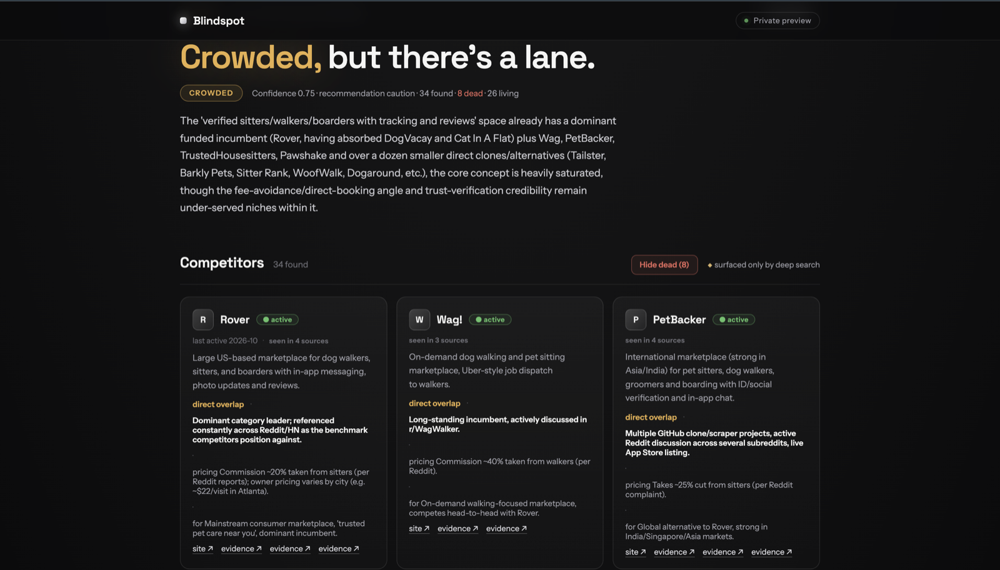

# Blindspot

**Find the competitors Google can't.** An "is this idea taken?" validator that surfaces the small, new, obscure players authority-ranked search structurally misses.



## What it does

You describe a product idea. Blindspot returns the competitive landscape: who's already building it, their pricing, positioning, traction and use case, and where the gaps are. It ends with a verdict (**taken / crowded / open lane**) backed by evidence links.

It runs on your machine with your own API keys. Nothing is hosted.

## Why it finds more

Google, Perplexity and ChatGPT rank by authority: backlinks, domain age, traffic. A three-week-old side project with 40 Product Hunt upvotes is invisible to them. Those obscure competitors are exactly what an idea validator must find.

Blindspot gets its recall from three things general search doesn't do:

1. **Search where builders self-publish:** Product Hunt, Hacker News, Reddit, SaaSHub "alternatives" pages, GitHub and the open web. One tool per source, run in parallel.
2. **Query expansion:** the idea is reframed many ways (the problem stated differently, alternate product names, adjacent categories), because tiny startups describe themselves in words you didn't use.
3. **Snowballing:** once a few competitors are found, their pages and "alternatives to" listings are mined for the rest.

## Requirements

- Node.js 20 or newer
- An [Anthropic API key](https://console.anthropic.com/) (required)
- A [Tavily API key](https://tavily.com/) (strongly recommended, free tier available)

## Setup

```bash
git clone https://github.com/keithdmonte/Blindspot.git
cd Blindspot
npm install
cp .env.example .env    # then add your keys
```

## Keys and sources

Only `ANTHROPIC_API_KEY` is required, but each optional key unlocks sources. **With the Anthropic key alone, Blindspot searches only Hacker News, GitHub and SaaSHub, and will miss many competitors.** Add a Tavily key for real results.

| Key | Unlocks |
|---|---|
| `ANTHROPIC_API_KEY` (required) | The agent itself, plus Hacker News, GitHub and SaaSHub alternatives |
| `TAVILY_API_KEY` (recommended) | Web search, page fetching and Reddit |
| `PRODUCTHUNT_API_TOKEN` | Product Hunt search with votes and launch dates (works best with Tavily too) |
| `GITHUB_TOKEN` | Higher GitHub rate limit (no scopes needed) |

Every option is documented in [`.env.example`](.env.example).

## Usage

### CLI

```bash
npm run blindspot -- "a tool that turns meeting recordings into follow-up emails"
```

A run prints the expanded queries and live search progress, then the report: verdict, competitors, gaps and sources, with a token and cost footer.

### Web UI

```bash
npm run serve    # http://localhost:3000
```

Enter an idea and watch the run stream live, then read the report: a verdict block, competitor cards, gap cards and a source-coverage table.

The server listens on `127.0.0.1` only. To reach it from other devices, set `HOST=0.0.0.0` **and** `APP_PASSWORD` in `.env`, otherwise anyone on your network can start runs on your API key.

## Cost

Each run costs about **$0.35–0.50** in Anthropic API usage, billed to your key. Tavily's free tier covers casual use. Set a monthly spend limit on your key in the Anthropic Console.

The default model is `claude-sonnet-5`. To use another, set `BLINDSPOT_MODEL` and its prices in `.env` (see `.env.example`).

## How it works

The agent expands your idea into a query set, fans out searches across the sources, follows promising leads, then ends every run by calling a `submit_report` tool. The report is structured data (`competitors[]`, `gaps[]`, `coverage[]`, verdict and confidence) that both the CLI and web UI render. See [`docs/TECHNICAL_DESIGN.md`](docs/TECHNICAL_DESIGN.md) for the design, [`docs/PRD.md`](docs/PRD.md) for the product spec and [`docs/SOURCES.md`](docs/SOURCES.md) for source details.

## Development

```bash
npm run typecheck
npm test
```

## Third-party terms

Blindspot reads public pages from SaaSHub and other sites, and calls the Hacker News, GitHub, Product Hunt and Tavily APIs. Each has its own terms of service and rate limits. You are responsible for following them when you run Blindspot. Product Hunt's API, for example, is non-commercial by default. See [`docs/SOURCES.md`](docs/SOURCES.md) for notes on each source.

## License

[MIT](LICENSE)
